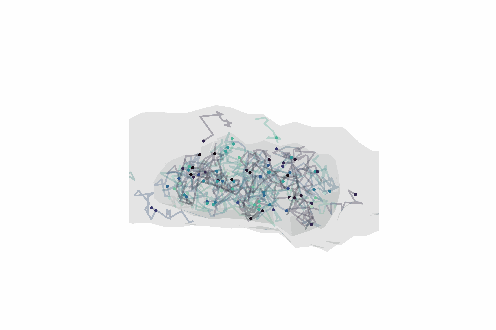

## Monte Carlo Synaptic Diffusion Simulation



## Overview
synSym is a tool used to simulate diffusion within a system defined by two three-dimensional geometry (.STL) files. We originally created this tool to simulate diffusion within a axonal geometry containing a smaller synaptic geometry (generated from ssTEM images, or CLSM images).
Particles are initialized within the geometries, and diffusion is simulated by independent random walks of each particle.

Simulations are run with the wrapper; and can be visualized using the visualizer.

## Inputs
.JSON file:

```
{
"simulation_type": "icbs",
"trimesh_axon": "trimesh_axon_repaired.stl",
"trimesh_synapse": "trimesh_synapse_repaired.stl",
"num_p_total": 1000,
"num_p_synapse": null,
"num_p_axon": null,
"D_synapse": 0.6161550277583344,
"D_axon": 0.6161550277583344,
"tau_sim": 0.0005,
"steps": 10000,
"leave_prob": null,
"pON": 0.1,
"pOFF": 0.0,
"seed": null,
"savefile": "simulation_icbs//6_sp"
}
```

There are three types of models that can be simulated using synSym: transient immobilizations (`icbs`), slowed diffusion (`mc`) and confining boundary (`cb`).

`simulation_type`: specifies the model (either `"icbs"`, `"mc"` or `"cb"`)

`trimesh_axon`: path to .STL file (the larger geometry; units in $\mu m$)

`trimesh_synapse`: path to .STL file (the smaller geometry within; units in $\mu m$)

`num_p_total`: total particles initialized; can be specified as `null` in this case specify an integer in, `num_p_synapse` and `num_p_axon`

`num_p_synapse`: if  `num_p_total` is not `null`, set as `null`; otherwise, specifies the number of particles initialized within the synapse

`num_p_axon`: if  `num_p_total` is not `null`, set as `null`; otherwise, specifies the number of particles initialized within the axon

`D_synapse`: diffusion coefficient of particles in the synapse ($\mu m^2/s$)

`D_axon`: diffusion coefficient of particles in the axon ($\mu m^2/s$)

`tau_sim`: the simulation time step

`steps`: number of steps to run the simulation for

`leave_prob`: `null`, but if model `cb` is specified, specifies the probability of particle being able to escape from the synapse (0, no escape; 1, free escape)

`pON`:  `null`, but if model `icbs` is specified, specifies the probability of a particle immobilizing within the synapse region.

`pOFF`: `null`, but if model `icbs` is specified, specifies the probability of a particle becoming un-immobilized within the synapse region.

`seed`: seed; only use if one trajectory is simulated

`savefile`: file path to output the saved file to

## Outputs

The output is a .JSON file, containing trajectories of each particle simulated.

## Acknowledgements

Axon and synapse geometries were created from ssTEM (3.8 nm × 3.8 nm × 50 nm resolution) acquisitions of the hippocampal area CA1 available through the Open NeuroData Registry (https://registry.opendata.aws/open-neurodata).
> Bloss, E.B., Cembrowski, M.S., Karsh, B. et al. Single excitatory axons form clustered synapses onto CA1 pyramidal cell dendrites. Nat Neurosci 21, 353–363 (2018). https://doi.org/10.1038/s41593-018-0084-6


